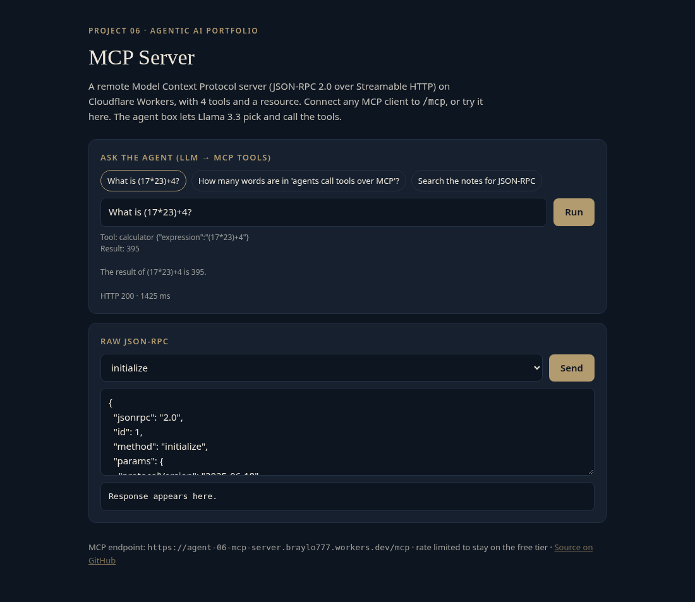
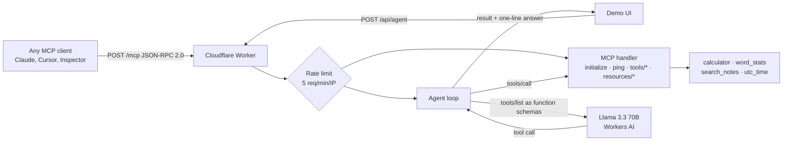

# agent-06-mcp-server

A remote **Model Context Protocol (MCP) server** on Cloudflare Workers, plus a small agent where Llama 3.3 acts as the MCP client and picks tools itself. JSON-RPC 2.0 over Streamable HTTP (stateless), on the free tier. Project 6 of a 10-part agentic AI portfolio.

**Live demo:** https://agent-06-mcp-server.braylo777.workers.dev · **MCP endpoint:** `https://agent-06-mcp-server.braylo777.workers.dev/mcp`



## What it is
- An MCP server any MCP client can connect to. It exposes 4 tools (`calculator`, `word_stats`, `search_notes`, `utc_time`) and 1 resource (`notes://all`).
- `/api/agent`: give it a task in plain English. Llama 3.3 reads the server's `tools/list`, chooses a tool and its arguments, the call runs through the same JSON-RPC handler, and the model answers from the result.

## Architecture


## How it works
- `src/mcp.js`: the MCP server. It validates the JSON-RPC envelope, echoes request ids, answers notifications with 202 and no body, supports batches, and uses the spec's error codes (`-32600`, `-32601`, `-32602`). A tool failure returns `isError: true` instead of crashing.
- `src/calc.js`: a safe arithmetic parser (no `eval`, which Workers forbid).
- `src/agent.js`: LLM-as-MCP-client. It turns `tools/list` into function-calling schemas and reads the model's tool call, either native `tool_calls` or a JSON-text fallback.
- Guardrails: 5 requests/min per IP, 500-character cap on agent tasks.

## Eval results
Run live against the deployed server (`node evals/run.mjs`). Raw per-case output is in [`evals/results.json`](evals/results.json). Run on Oct 27, 2026.

| Metric | Result | Definition |
|---|---|---|
| Protocol compliance | **12/12 (1.00)** | JSON-RPC 2.0/MCP checks on `/mcp`: valid envelope, id echoed, correct result or error code, notification → 202, batch, resources |
| Tool-call success (LLM) | **8/8 (1.00)**, 2 not run | Llama 3.3 picked the right tool, the call succeeded, and the result held the expected value |
| Tool selection accuracy | **8/8 (1.00)**, 2 not run | Right tool chosen |
| Latency `/mcp` p50 / p95 | **94 ms / 209 ms** (n=12) | End-to-end from the eval client |
| Latency `/api/agent` p50 / p95 | **1978 ms / 4987 ms** (n=8) | Two model calls + one tool call |

2 of the 10 agent cases did not run: the account's shared Workers AI daily free allocation ran out mid-eval. They are excluded from the rates, not counted as passes. Sample sizes are small (12 protocol cases, 8 agent cases), so treat these as smoke-level numbers.

## Tests
17 offline unit tests (`node:test`, model mocked): every JSON-RPC method, error codes, id echo, notifications, batches over HTTP, 405 on GET, calculator precedence and bad input, `word_stats`, `search_notes` hit and miss, resources, tool-schema mapping, parsing native and JSON-text tool calls, and the agent routing a model's call through MCP.

```bash
npm test
```

## Run it
```bash
npm install
npm test             # offline unit tests (Node 20+)
npx wrangler dev     # local
npx wrangler deploy  # free tier, no paid API keys
node evals/run.mjs   # live eval, throttled to the rate limit; writes evals/results.json
```
Connect a client: `npx @modelcontextprotocol/inspector`, then choose transport "Streamable HTTP" and URL `<your-worker>/mcp`.

## Stack
Cloudflare Workers · Workers AI (Llama 3.3 70B, function calling) · MCP 2025-06-18 · vanilla JS · node:test

## License
MIT
